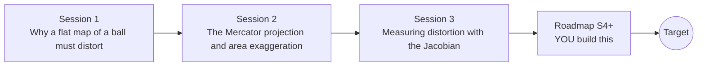

# openmapproject

[](https://github.com/KrunalPanchal1995/openmapproject/actions/workflows/ci.yml)   [](https://colab.research.google.com/github/KrunalPanchal1995/openmapproject/blob/main/sessions/session-01/lesson.ipynb) [](https://krunalpanchal1995.github.io/openmapproject/)

**Choose a map projection by measuring how it distorts the Earth, in three sessions.**

openmapproject teaches why every flat map of a sphere lies, and how to measure the lie with a Jacobian, using only Python and a browser.

- **Start from an orange.** Session 1 needs only school trigonometry: why a flat map of a ball must stretch.
- **See it move.** Every session ships a slider app that runs in the browser, with labelled graphs and ellipses.
- **Measure, do not guess.** Session 3 computes distortion numerically and checks it against formulas and the area of the sphere.
- **Build the missing half.** The repo stops at three simple cylindrical maps on purpose; the roadmap shows the path to the Target.

[Target](#the-target) · [Who is this for](#who-is-this-for) · [Quick start](#quick-start) · [Sessions](#sessions) · [Roadmap](#roadmap) · [Contribute](#contribute) · [Explainer PDF](docs/explainer.pdf)

> **This repo is incomplete on purpose.** Sessions 1 to 3 are here and fully working. The finished Target below is a preview of what the community can build next. We show you the path, not the code. Sessions 4 and up are yours.

## The Target

A globe unrolls into flat maps while small identical circles (Tissot circles) are drawn on it. On the globe they are all round and equal. On the equirectangular map they stretch sideways toward the poles. On the Mercator map they stay round but swell. On the sinusoidal map they keep their area but lean over. On the equal-area cylindrical map they keep their area but squash into thin ellipses. Your goal over the coming sessions: build that unrolling yourself and use it to decide which map suits a job.


*Target: a globe unrolls into four projections while Tissot circles stretch*

- [Spherical coordinates: latitude, longitude and the sphere (video)](promo/media/spherical_coordinates.mp4)

- [The Jacobian turns a tiny square into a tiny parallelogram (video)](promo/media/jacobian.mp4)

Try it live:

- [Math Visual Studio: multiple integration and change of variables (Atlas S14)](https://krunalpanchal1995.github.io/studio/#atlas?ch=S14&ex=1)
- [Math Visual Studio: vector calculus on surfaces (Atlas S15)](https://krunalpanchal1995.github.io/studio/#atlas?ch=S15&ex=1)

How the Target was made is shown only as a path in [promo/roadmap.md](promo/roadmap.md).

## Who is this for
**secondary school to diploma / undergraduate (levels 3-5).** Topic area: Mathematics and Visual Problem-Solving.

Prerequisites:

- Sine, cosine and the idea of a slope (school trigonometry and gradients).
- Python 3.10 or newer; if `python --version` works, you are ready. PRIMER.md explains the rest.
- No prior GitHub, calculus of several variables or mapping experience is needed; the Jacobian is explained from scratch.

New to Python? Read [PRIMER.md](PRIMER.md) first (10 minutes).

## Quick start

No installation knowledge needed. You need [Git](https://git-scm.com/downloads) and [Python 3.10+](https://www.python.org/downloads/) (Windows: tick "Add Python to PATH"). On Mac and Linux type `python3` wherever this page says `python`.

```bash
git clone https://github.com/KrunalPanchal1995/openmapproject.git
cd openmapproject
python start.py 1
```

`start.py` creates a private environment, installs what is needed and runs Session 1 with its checkpoint. Next: `python start.py 2`, `python start.py 3`, or `python start.py test` to check everything. Only a checkpoint: `python start.py check 1`.

Four lines turn the idea of Session 1 into a result (they work as they are): Save it as `try.py` and run it with `python start.py run try.py` (this uses the private environment, where NumPy is installed):

```python
import numpy as np
lat = np.radians(60)                          # 60 degrees north
print(round(1 / np.cos(lat), 3))               # -> 2.0  east-west lengths are drawn twice too long
print(round(1 / np.cos(lat) ** 2, 3))          # -> 4.0  and Mercator areas four times too big
```

Every session also opens in your browser with sliders (no install): [live apps](https://krunalpanchal1995.github.io/openmapproject/). Or use the Colab badge above for the notebook.

## Sessions

| # | Session | Model level | Time | Live app |
|---|---|---|---|---|
| 1 | [Why a flat map of a ball must distort](sessions/session-01/README.md) | Level 1: conceptual interactive model | 60 min | [open](https://krunalpanchal1995.github.io/openmapproject/session-01/) |
| 2 | [The Mercator projection and area exaggeration](sessions/session-02/README.md) | Level 2: mathematical engineering model | 75 min | [open](https://krunalpanchal1995.github.io/openmapproject/session-02/) |
| 3 | [Measuring distortion with the Jacobian](sessions/session-03/README.md) | Level 3: simulation and validation | 90 min | [open](https://krunalpanchal1995.github.io/openmapproject/session-03/) |

Each session follows the same six steps: A real-world problem, B concept and theory, C visual explanation, D interactive simulation, E worked example and experiment, F assessment and design challenge. Each ends with `checkpoint.py`, which prints `PASS` or `FAIL` against reference numbers. Session 3 also contains the real-world mini-project: **Choose and justify a projection for a country**.

## Architecture



| Folder or file | What is inside |
|---|---|
| `sessions/` | three sessions: README (A-F), `lesson.py`, notebook, live app, exercises, activity sheet, checkpoint |
| `promo/` | the Target: media, live links, and the roadmap (path only) |
| `docs/` | `explainer.tex` and the built `explainer.pdf` |
| `tests/` | runs every lesson and checkpoint headless |
| `start.py` | one command to set up and run anything |
| `QUALITY.md`, `RUBRIC.md` | the quality checklist and the scoring rubric |
| `.github/` | CI, PDF build, Pages deploy, issue and PR templates |

## Roadmap

| Milestone | What you will build | Difficulty |
|---|---|---|
| Session 4: A compromise world map | A new projection function with a numerical Jacobian, plus a world picture with Tissot ellipses. | intermediate |
| Session 5: A polar map | An azimuthal map with its own finite-difference distortion table. | intermediate |
| Session 6: A conformal conic map for a country | A Lambert conformal conic function and a comparison with the four shipped maps. | advanced |
| Session 7: Routes across the dateline | A route tool that draws great circles on three projections and reports lengths. | advanced |
| Session 8: Unroll the globe | An animation of a globe unrolling into several maps with moving Tissot circles. | advanced |

Full detail with a checkpoint per milestone: [promo/roadmap.md](promo/roadmap.md).

## Contribute
New to GitHub? Read [CONTRIBUTING.md](CONTRIBUTING.md); it starts from zero. Pick an issue labelled `good first issue`. Translations into Hindi, Telugu, Tamil and Malayalam are welcome.

<details>
<summary>Development</summary>

```bash
python start.py test        # runs every lesson and checkpoint
```
Lessons use `# %%` cell markers so they open as notebooks in VS Code. See [QUALITY.md](QUALITY.md) for the standard every session meets.
</details>

## License
MIT. See [LICENSE](LICENSE). Media in `promo/media` is (c) Krunal Panchal, CC BY 4.0.

## Acknowledgments
Part of the [PAN IIT OSS](https://hellofoss.tech-iitb.org/projects) open-source teaching collection, modelled on the structure of [openspline](https://github.com/openspline/openspline). Built on ideas from the Math Visual Studio at https://krunalpanchal1995.github.io/studio/.
