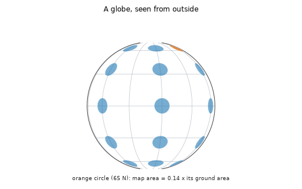

# What you are building toward

A globe unrolls into flat maps while small identical circles (Tissot circles) are drawn on it. On the globe they are all round and equal. On the equirectangular map they stretch sideways toward the poles. On the Mercator map they stay round but swell. On the sinusoidal map they keep their area but lean over. On the equal-area cylindrical map they keep their area but squash into thin ellipses. Your goal over the coming sessions: build that unrolling yourself and use it to decide which map suits a job.

*Target: a globe unrolls into four projections while Tissot circles stretch*

- [Spherical coordinates: latitude, longitude and the sphere (video)](media/spherical_coordinates.mp4)

- [The Jacobian turns a tiny square into a tiny parallelogram (video)](media/jacobian.mp4)

These results come from a private reference build. The code is not published; the roadmap shows the path so you can build your own.

Live links:

- [Math Visual Studio: multiple integration and change of variables (Atlas S14)](https://krunalpanchal1995.github.io/studio/#atlas?ch=S14&ex=1)
- [Math Visual Studio: vector calculus on surfaces (Atlas S15)](https://krunalpanchal1995.github.io/studio/#atlas?ch=S15&ex=1)
