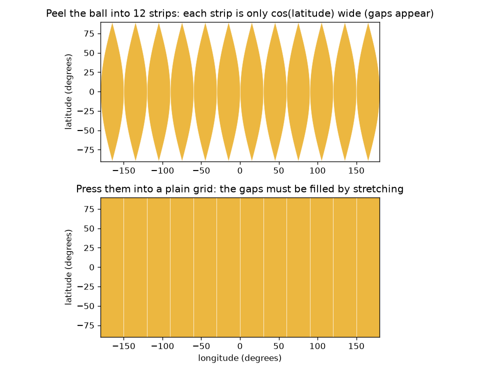
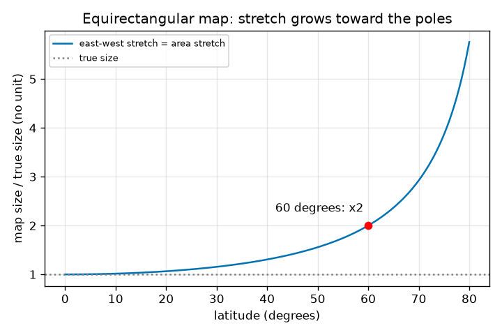

# Session 1: Why a flat map of a ball must distort

*Level 1 (conceptual interactive model) · about 60 minutes · openmapproject*

> This is a simplified educational model. It is not a validated design tool and must not be used for real structures, electrical installations, vehicles, industrial processes or medical decisions.

**Prerequisites**

- School trigonometry: the cosine of an angle.
- You have read PRIMER.md and run `python start.py 1` once.

**Learning objectives.** After this session you can:

- Explain, with the orange peel, why a sphere cannot be flattened without stretching or tearing.
- Describe a point on the Earth by latitude and longitude and place it on the equirectangular map.
- Compute the true length of a circle of latitude and the stretch 1 / cos(latitude) of the flat grid map.
- Read a graph of stretch against latitude.

## A. Real-world problem
Peel an orange in one piece and press the peel flat on a table. It splits, or you have to stretch it. The Earth is a ball, and every flat map of it is a pressed peel. The simplest map just uses latitude and longitude as grid lines on squared paper. Does it show Norway and Nigeria at the right size? How wrong is it at 60 degrees north, and why?

## B. Concept and theory
Latitude is the angle north (+) or south (-) of the equator; longitude is the angle east or west of a reference meridian. On the equirectangular map a point at latitude phi and longitude lambda (in radians) is drawn at x = R lambda, y = R phi, where R is the radius of the ball. A circle of latitude has radius R cos(phi), so its true length is 2 pi R cos(phi). The map draws every circle of latitude with the length of the equator, 2 pi R. So east-west distances are drawn too long by the factor 1 / cos(phi), while north-south distances are drawn at their true size. Area is the product of the two, so the area on the map is the true area times 1 / cos(phi).

| Symbol | Meaning | Unit |
|---|---|---|
| phi | latitude, positive north | radians (degrees in the app) |
| lambda | longitude, positive east | radians (degrees in the app) |
| R | radius of the sphere (6371 km for the Earth) | km |
| x, y | position on the flat map | km |
| stretch | map length divided by true length | no unit |

**Assumptions**

- The Earth is a perfect sphere of radius 6371 km (the real Earth is flattened by about 0.3 percent).
- Angles are in radians inside formulas; the app and the text use degrees.
- This is a simplified educational model.

$$ x = R\lambda,\qquad y = R\varphi $$

$$ L_{\text{true}}(\varphi)=2\pi R\cos\varphi,\qquad L_{\text{map}}=2\pi R $$

$$ \text{east-west stretch}=\frac{L_{\text{map}}}{L_{\text{true}}}=\frac{1}{\cos\varphi}=\sec\varphi $$

$$ \frac{\text{area on map}}{\text{true area}}=\sec\varphi $$

## C. Visual explanation
The first figure peels the ball into 12 strips. On the ball each strip is only cos(latitude) wide, so gaps open toward the poles; the plain grid below it fills the gaps by stretching the strips sideways. The second figure plots the stretch 1 / cos(latitude) against latitude: it is 1 at the equator, 1.155 at 30 degrees, exactly 2 at 60 degrees and 5.76 at 80 degrees, and it grows without limit at the pole.

*The peeled ball: strips narrow with latitude, so the plain grid has to stretch them.*

*East-west stretch 1 / cos(latitude): 1 at the equator, 2 at 60 degrees, 5.76 at 80 degrees.*

## D. Interactive simulation
Run the lesson (`python start.py 1`), then open the live app: [Session 1: how much does the flat grid map stretch?](https://krunalpanchal1995.github.io/openmapproject/session-01/) (or `app.html` in this folder). Move the latitude slider and watch the blue patch on the map and the green true shape on the ball: the blue patch keeps its width while the green one narrows. Then open the graph view and see where the dot sits on the curve. Change the patch width and note which numbers change.

**Challenge.** Find a latitude where the flat map stretches east-west distances by at least 1.99 times (about 2).

## E. Worked example and experiment
**Problem.** How long is the circle of latitude at 60 degrees north on a ball of radius 6371 km, how long does the flat grid map draw it, and what is the stretch?

1. Equator: 2 pi R = 2 x 3.14159 x 6371 = 40030.2 km. The map draws every circle of latitude with this length.
2. True circle at 60 degrees: 2 pi R cos 60 = 40030.2 x 0.5 = 20015.1 km.
3. Stretch = map length / true length = 40030.2 / 20015.1 = 2.000. This is 1 / cos 60 = 1 / 0.5 = 2.
4. One degree of longitude is R x pi/180 = 111.19 km at the equator but only 55.60 km at 60 degrees north; the map draws both as 111.19 km.

**Answer.** The true circle is 20015.1 km, the map draws 40030.2 km, so east-west lengths and areas are drawn twice too large at 60 degrees north.

**Experiment.** Take an orange and a marker. Draw the equator and a circle of latitude about 60 degrees north (two thirds of the way from the equator to the pole along the surface). Wind a string around each circle and measure the two lengths: you should find a ratio close to 2. Compare with the app and with checkpoint.py. The model has a perfect sphere; a real orange is lumpy and your string has thickness, so expect an error of a few percent.

## F. Assessment and design challenge
**Question type A: Conceptual.** Why can the peel of an orange not be pressed flat without tearing or stretching? What does this mean for every flat map of the Earth?

Hint

Compare the length of a circle of latitude on the ball with the width the flat grid gives it.

Step-by-step solution

Near the poles the peel is pinched into narrow strips: a circle of latitude is much shorter than the equator (cos of the latitude times as long). A flat rectangle has the same width at every height, so to fill it the strips must be stretched sideways or you must leave gaps. Any flat map must therefore change some lengths, areas or angles. It cannot be perfect everywhere; you choose which defect to accept.

**Question type B: Numerical.** At 45 degrees north, what is the true length of 10 degrees of longitude, how long does the equirectangular map draw it, and what is the stretch? Use R = 6371 km.

Hint

True length = R cos(phi) times the angle in radians; map length = R times the angle in radians.

Step-by-step solution

10 degrees = 0.17453 radians. True length = 6371 x cos 45 x 0.17453 = 6371 x 0.70711 x 0.17453 = 786.3 km. Map length = 6371 x 0.17453 = 1111.9 km. Stretch = 1111.9 / 786.3 = 1.414 = 1 / cos 45. Sanity check: it lies between 1 (equator) and 2 (60 degrees), as it should.

**Question type C: Graph and simulation interpretation.** In the stretch graph, read the stretch at 60 degrees and at 80 degrees. By how many times does the area of a country of fixed size grow between 60 and 80 degrees on this map?

Hint

Area stretch equals east-west stretch on this map.

Step-by-step solution

The curve passes through 2.00 at 60 degrees and 5.76 at 80 degrees. A country of fixed true size therefore looks 5.76 / 2.00 = 2.88 times larger at 80 degrees than at 60 degrees. The curve rises more and more steeply: the map is much worse near the pole than in the middle latitudes.

**Question type D: Design and optimisation challenge.** A weather office wants a flat grid map of a region in which east-west lengths are never stretched by more than 25 percent. What is the highest latitude the region may reach? What would you do for a region that reaches 70 degrees?

Hint

Solve 1 / cos(phi) = 1.25.

Step-by-step solution

cos(phi) = 1 / 1.25 = 0.8, so phi = 36.9 degrees. The region may reach 36.9 degrees north or south. At 70 degrees the stretch is 1 / cos 70 = 2.92, so the plain grid is unsuitable; choose a different projection (Sessions 2 and 3) or a map centred on that latitude. Trade-off: the plain grid is the simplest to compute and plot, but only good near the equator.

Score yourself with [RUBRIC.md](../../RUBRIC.md). Print the [activity sheet](activity_sheet.md) to work on paper.

## Common misconceptions
| Common misconception | What is actually true |
|---|---|
| A flat map can be made perfect if the mapmaker is careful enough. | No flat map of a sphere can keep all lengths, angles and areas; some distortion is unavoidable. |
| The pole is a long line at the top of the map in reality. | The pole is a single point; the plain grid draws it as the whole top edge, which is the extreme case of the stretch. |
| Equal spacing of the grid lines means equal distances on the ground. | One degree of latitude is always 111.19 km, but one degree of longitude shrinks by cos(latitude), becoming 55.60 km at 60 degrees. |
| The distortion is the same everywhere on the map. | On the plain grid it is zero on the equator and grows toward the poles; distortion depends on the place. |

## Glossary
- **latitude**: angle north or south of the equator, from -90 to +90 degrees
- **longitude**: angle east or west of the reference meridian, from -180 to +180 degrees
- **equirectangular map**: the map that uses longitude and latitude as plain grid coordinates
- **circle of latitude**: all points at the same latitude; also called a parallel
- **stretch**: map length divided by the true length it stands for

## Finish
1. Do the three coding tasks in [exercises.md](exercises.md).
2. Run `python start.py 1` again after your changes. It ends with the checkpoint; when it prints `PASS`, you are done. (Checkpoint only: `python start.py check 1`.)

Next: [Session 2](../session-02/README.md)
