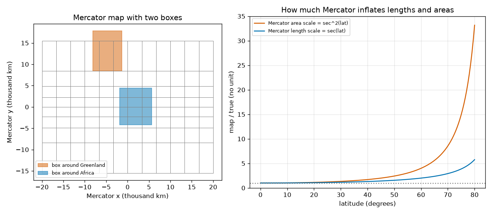

# Session 2: The Mercator projection and area exaggeration

*Level 2 (mathematical engineering model) · about 75 minutes · openmapproject*

> This is a simplified educational model. It is not a validated design tool and must not be used for real structures, electrical installations, vehicles, industrial processes or medical decisions.

**Prerequisites**

- Session 1: latitude, longitude and the stretch 1 / cos(latitude).
- The natural logarithm ln and the tangent function.

**Learning objectives.** After this session you can:

- Write the sphere as X, Y, Z equations of latitude and longitude.
- Compute the Mercator coordinates of a point and invert them.
- Explain why Mercator keeps small shapes but inflates areas by 1 / cos^2(latitude).
- Compute true and apparent areas of two regions and find the latitude limit for a given exaggeration.

## A. Real-world problem
A sailor wants to steer by a constant compass bearing and draw the course as one straight line on the chart. In 1569 Mercator made such a map, and navigators adopted it. But on it a box around Greenland looks as big as a box around Africa, although Africa is many times larger. How can a map be so useful and so misleading at once, and up to which latitude is it still honest?

## B. Concept and theory
A point at latitude phi and longitude lambda on a sphere of radius R has the 3D position (R cos phi cos lambda, R cos phi sin lambda, R sin phi). The Mercator map uses x = R lambda and y = R ln tan(pi/4 + phi/2). A small step east and a small step north are both enlarged by the same factor sec(phi) = 1 / cos(phi). Equal enlargement in all directions means small shapes and all angles are kept (the map is conformal) and this is why a constant compass bearing is a straight line. But area is enlarged by sec^2(phi). A lat/lon box has the true area R^2 (lambda2 - lambda1)(sin phi2 - sin phi1), and on the Mercator map the same box is a rectangle of area R^2 (lambda2 - lambda1)(psi2 - psi1) with psi = ln tan(pi/4 + phi/2). Compare these two numbers to see the exaggeration. Which projection to use depends on the job: keep angles (navigation, aviation charts), keep areas (population density maps), or keep distances from one centre (polar maps).

| Symbol | Meaning | Unit |
|---|---|---|
| phi, lambda | latitude and longitude | radians |
| R | radius of the Earth, 6371 km | km |
| x, y | Mercator position | km |
| sec(phi) | local length scale of Mercator, 1 / cos(phi) | no unit |
| k | area exaggeration (map area / true area) | no unit |
| psi | Mercator height, ln tan(pi/4 + phi/2) | no unit |

**Assumptions**

- Spherical Earth of radius 6371 km.
- Longitude is measured from the central meridian; it only shifts the picture sideways.
- Regions are replaced by crude latitude-longitude boxes, not real coastlines; the boxes are bigger than the real countries.
- This is a simplified educational model.

$$ X=R\cos\varphi\cos\lambda,\quad Y=R\cos\varphi\sin\lambda,\quad Z=R\sin\varphi $$

$$ x=R\lambda,\qquad y=R\ln\tan\!\left(\frac{\pi}{4}+\frac{\varphi}{2}\right) $$

$$ h=k_{\text{north}}=\sec\varphi,\qquad \text{area scale}=\sec^2\varphi $$

$$ A_{\text{sphere}}=R^2(\lambda_2-\lambda_1)(\sin\varphi_2-\sin\varphi_1),\qquad A_{\text{Mercator}}=R^2(\lambda_2-\lambda_1)(\psi_2-\psi_1) $$

$$ \varphi_{\max}=\arccos\frac{1}{\sqrt{k}} $$

## C. Visual explanation
The left plot shows a Mercator graticule with a box around Greenland (lat 60 to 83, lon -73 to -12) and a box around Africa (lat -35 to 37, lon -17 to 51). The Greenland box looks nearly as big as the Africa box. The right plot shows the area exaggeration sec^2(latitude): 1 at the equator, 2 at 45 degrees, 4 at 60 degrees and 33.2 at 80 degrees, while the length scale sec(latitude) rises more slowly.

*Left: a box around Greenland and a box around Africa on a Mercator map. Right: area exaggeration 1 / cos^2(latitude) and length scale 1 / cos(latitude).*

## D. Interactive simulation
Run the lesson (`python start.py 2`), then open the live app: [Session 2: two equal countries on a Mercator map](https://krunalpanchal1995.github.io/openmapproject/session-02/) (or `app.html` in this folder). Choose a latitude for a north country and for a south country of the same true size. The red and blue discs on the map have the same true size but the red one is drawn larger the further north it is. Use the graph view to see where each sits on the exaggeration curve.

**Challenge.** Make the north country look at least 3.99 times larger than the south country (equal in reality).

## E. Worked example and experiment
**Problem.** Find the Mercator position (x, y) of the point at latitude 60 degrees north and longitude 30 degrees east, its area exaggeration, and the apparent size ratio of the two boxes in Section C.

1. x = R lambda = 6371 x (30 x pi/180) = 6371 x 0.5236 = 3335.8 km.
2. y = R ln tan(45 + 30 degrees) = 6371 x ln tan 75 = 6371 x ln 3.7321 = 6371 x 1.31696 = 8390.3 km.
3. Area exaggeration = 1 / cos^2 60 = 1 / 0.25 = 4.0, and the length scale is 2.0.
4. Boxes: true areas are 5.47 million km2 (Greenland box) and 56.62 million km2 (Africa box), a ratio of 10.36. On the Mercator map the box areas are 63.84 and 64.98 million (map) km2, a ratio of only 1.02.

**Answer.** The point maps to (3335.8, 8390.3) km with area exaggeration 4; the Africa box is truly 10.36 times the Greenland box but the Mercator map shows them almost equal (ratio 1.02).

**Experiment.** Use a globe and a world atlas with a Mercator page. Cut a paper square about 5 degrees across at the equator and another at 60 degrees north (use the grid lines and the same angular size). On the globe they are the same size; on the Mercator page measure their sides with a ruler. The northern one should be about twice as wide and tall, so four times the area. The model matches the idea; differences come from reading grid lines and from atlas pages that are not exactly Mercator.

## F. Assessment and design challenge
**Question type A: Conceptual.** Why does Mercator keep the shape of small objects but not their area?

Hint

Compare the enlargement along the parallel with the enlargement along the meridian, and recall that area is length times width.

Step-by-step solution

At each point Mercator enlarges the east-west and the north-south direction by the same factor sec(phi). Equal enlargement in both directions keeps angles and so the shape of a small object. Area is a product of two lengths, so it is enlarged by sec(phi) times sec(phi) = sec^2(phi), which grows quickly toward the poles.

**Question type B: Numerical.** Compute the Mercator coordinates (x, y) in km of the point at latitude 50 degrees north, longitude 10 degrees east, and the area exaggeration there.

Hint

x = R lambda; y = R ln tan(pi/4 + phi/2) with phi = 50 degrees, so pi/4 + phi/2 = 70 degrees.

Step-by-step solution

x = 6371 x 0.17453 = 1111.9 km. y = 6371 x ln tan 70 = 6371 x ln 2.7475 = 6371 x 1.0107 = 6439.1 km. Area exaggeration = 1 / cos^2 50 = 1 / 0.4132 = 2.42. Sanity check: between 1 (equator) and 4 (60 degrees).

**Question type C: Graph and simulation interpretation.** From the exaggeration curve, at about what latitude does Mercator inflate area by a factor 4, and what is the factor at 80 degrees?

Hint

Solve 1 / cos^2(phi) = 4 and read the curve at 80.

Step-by-step solution

cos^2 phi = 0.25, so cos phi = 0.5 and phi = 60 degrees. At 80 degrees the curve gives 33.2. So a country at 80 degrees looks 33 times too big, compared with 4 times at 60 degrees: the exaggeration explodes toward the poles.

**Question type D: Design and optimisation challenge.** Design: (1) What latitude limit keeps Mercator's area exaggeration at most 3? (2) Which map property do you need for a world map of population density per square kilometre, for a sea chart, and for a map of the Arctic? Justify each in one line.

Hint

Use phi_max = arccos(1 / sqrt(k)) for part 1.

Step-by-step solution

(1) cos phi = 1 / sqrt(3) = 0.5774, phi = 54.7 degrees. Within 54.7 degrees of the equator the exaggeration is at most 3 (at most 2 within 45 degrees). (2) Population density needs equal areas, because density is people divided by area and the area must be right. A sea chart needs angles kept (conformal) so a compass bearing is a straight line: Mercator. The Arctic is best drawn with a map centred on the pole (azimuthal), because Mercator cannot show the pole at all. This is general guidance; real mapmakers also weigh familiarity and cost.

Score yourself with [RUBRIC.md](../../RUBRIC.md). Print the [activity sheet](activity_sheet.md) to work on paper.

## Common misconceptions
| Common misconception | What is actually true |
|---|---|
| Mercator is a bad map and should never be used. | It keeps angles, so it is excellent for navigation and for web map tiles of a city; it is only misleading for comparing sizes. |
| If shapes look right, the sizes are right too. | Mercator keeps small shapes but inflates areas by sec^2(latitude); shape and size are different properties. |
| The north pole is at the top edge of a Mercator map. | The pole is at infinite height (y goes to infinity as the latitude goes to 90 degrees), so a Mercator map must be cut off. |
| The exaggeration is a fixed number for the whole map. | It depends on latitude: 1 at the equator, 4 at 60 degrees, 33 at 80 degrees. |

## Glossary
- **Mercator projection**: the cylindrical map with x = R lambda and y = R ln tan(pi/4 + phi/2)
- **conformal**: a map that keeps angles, and so the shape of small things
- **equal-area**: a map in which the area of every region is drawn at the right scale
- **scale factor**: map length divided by true length at one point and in one direction
- **azimuthal map**: a map centred on one point, with directions from that point kept true
- **secant, sec**: 1 divided by the cosine

## Finish
1. Do the three coding tasks in [exercises.md](exercises.md).
2. Run `python start.py 2` again after your changes. It ends with the checkpoint; when it prints `PASS`, you are done. (Checkpoint only: `python start.py check 2`.)

Next: [Session 3](../session-03/README.md)
