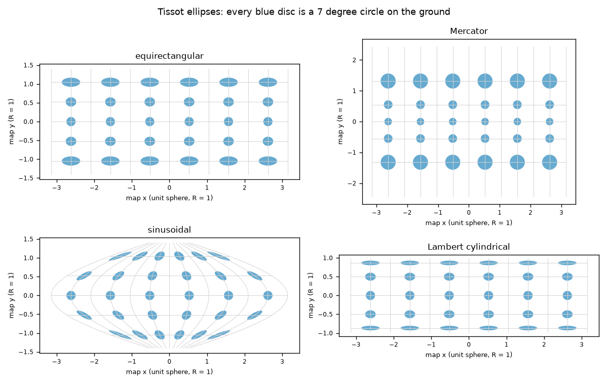
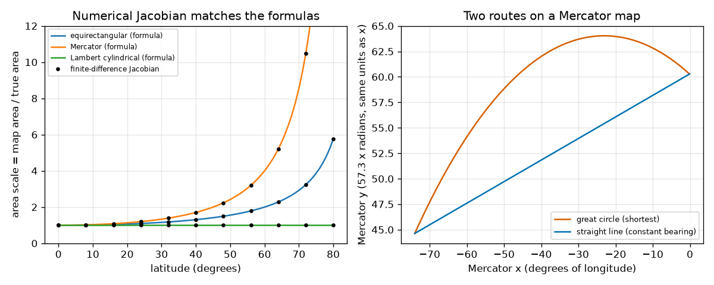

# Session 3: Measuring distortion with the Jacobian

*Level 3 (simulation and validation) · about 90 minutes · openmapproject*

> This is a simplified educational model. It is not a validated design tool and must not be used for real structures, electrical installations, vehicles, industrial processes or medical decisions.

**Prerequisites**

- Session 1: stretch on the flat grid map.
- Session 2: Mercator and sec(latitude).
- A 2 x 2 matrix and its determinant (explained in Section B).

**Learning objectives.** After this session you can:

- Compute the Jacobian of a map projection by finite differences.
- Read scale factors, area scale and angle error from the singular values of the Jacobian.
- Validate the numerical result against formulas and against the area of the sphere, 4 pi R^2.
- Compare the shortest route with the straight line on Mercator, and explain why Mercator fails at the poles.

## A. Real-world problem
A national mapping agency must choose one projection for its country. Looking at pictures is not enough: it needs numbers for how much each projection stretches lengths, spoils angles and inflates areas at every point. All of this is contained in one small matrix at each point, the Jacobian. Can we compute it for any projection, trust it, and use it to pick the best map for a region and for a purpose?

## B. Concept and theory
A projection sends (latitude phi, longitude lambda) to a map position (x, y). On the unit sphere a small step d(phi) north has length d(phi) and a small step d(lambda) east has length cos(phi) d(lambda). The Jacobian J is the 2 x 2 matrix that turns a tiny ground step (in true length) into a tiny map step: J = [[x_lambda / cos phi, x_phi], [y_lambda / cos phi, y_phi]]. We estimate each derivative with a central difference f(t + h) - f(t - h) over 2h. A tiny circle on the ground becomes an ellipse (the Tissot indicatrix). Its semi-axes are the singular values s1 >= s2 of J: the largest and the smallest stretch. The area scale is s1 s2 = |det J|. The angle error is omega = 2 arcsin((s1 - s2)/(s1 + s2)); omega = 0 means the map is conformal and s1 = s2. For the four maps studied here: equirectangular (x = lambda, y = phi) has h = sec phi, k = 1; Mercator has h = k = sec phi; Lambert cylindrical equal-area (x = lambda, y = sin phi) has h = sec phi, k = cos phi, area 1; sinusoidal (x = lambda cos phi, y = phi) has area scale 1. Check: the area of the whole map is the sum of (area scale) x (true cell area cos phi d(phi) d(lambda)); equal-area maps give the area of the sphere, 4 pi R^2.

| Symbol | Meaning | Unit |
|---|---|---|
| J | local Jacobian, from true ground length to map length | no unit (R = 1) |
| s1, s2 | largest and smallest stretch (singular values of J) | no unit |
| area scale | s1 x s2 = \|det J\|, map area / true area | no unit |
| omega | largest angle error at the point | degrees |
| h | finite-difference step | radians (1e-5) |
| R | sphere radius (1 inside the code, 6371 km for the Earth) | km |

**Assumptions**

- Unit sphere; multiply lengths by R and areas by R^2 for the Earth.
- Finite differences with h = 1e-5 radians have an error far below the 1e-5 tolerances used in the checks.
- The projections are evaluated away from the poles, where cos(phi) = 0.
- Longitude is measured from the central meridian (the middle of the region for the sinusoidal map).
- This is a simplified educational model.

$$ J=\begin{pmatrix}\dfrac{1}{\cos\varphi}\dfrac{\partial x}{\partial\lambda} & \dfrac{\partial x}{\partial\varphi}\\[2mm] \dfrac{1}{\cos\varphi}\dfrac{\partial y}{\partial\lambda} & \dfrac{\partial y}{\partial\varphi}\end{pmatrix} $$

$$ \frac{\partial f}{\partial t}\approx\frac{f(t+h)-f(t-h)}{2h} $$

$$ s_{1,2}=\text{singular values of }J,\qquad \text{area scale}=s_1s_2=|\det J| $$

$$ \omega=2\arcsin\frac{s_1-s_2}{s_1+s_2} $$

$$ A_{\text{map}}=\iint |\det J|\,\cos\varphi\,d\varphi\,d\lambda\quad(=4\pi R^2\text{ for an equal-area map of the whole sphere}) $$

## C. Visual explanation
The first figure draws each of the four graticules with 7-degree Tissot circles drawn from the Jacobian. On the equirectangular map the discs are stretched sideways toward the poles; on Mercator they stay round but swell toward the poles; on the sinusoidal map they keep their area but lean over far from the central meridian; on the Lambert cylindrical map they keep their area but are squashed flat toward the poles. The second figure compares the numerical area scale (dots) with the formulas (lines): they agree. Its right panel shows London to New York on a Mercator map: the great circle bows north of the straight line.

*Tissot ellipses (7 degree ground circles) for the four projections, drawn from the Jacobian.*

*Left: finite-difference area scale (dots) agrees with the formulas (lines). Right: great circle versus straight line on Mercator, London to New York.*

## D. Interactive simulation
Run the lesson (`python start.py 3`), then open the live app: [Session 3: the Tissot ellipse from the Jacobian](https://krunalpanchal1995.github.io/openmapproject/session-03/) (or `app.html` in this folder). Choose a projection, a latitude and a distance from the central meridian, and watch the dashed circle turn into a filled ellipse. Open the area and angle-error graphs to compare all four projections at your latitude.

**Challenge.** At latitude 60 degrees or more, choose an equal-area projection (the sinusoidal map) with at most 10 degrees of longitude from the central meridian, so that the angle error stays under 10 degrees.

## E. Worked example and experiment
**Problem.** Find the scale factors, area scale and angle error of the Lambert cylindrical equal-area projection at 60 degrees north, by hand and by the finite-difference Jacobian. Then compare the great circle and the Mercator straight line from London (51.5 N, 0.1 W) to New York (40.7 N, 74.0 W).

1. Lambert cylindrical: x = lambda, y = sin phi. So x_lambda = 1, x_phi = 0, y_lambda = 0, y_phi = cos phi.
2. J = [[1 / cos 60, 0], [0, cos 60]] = [[2, 0], [0, 0.5]]. The singular values are s1 = 2 and s2 = 0.5.
3. Area scale = 2 x 0.5 = 1 (equal-area), and omega = 2 arcsin(1.5 / 2.5) = 2 arcsin(0.6) = 73.74 degrees.
4. The finite-difference Jacobian in Python gives s1 = 2.000, s2 = 0.500, area 1.000, omega 73.74 degrees: the same.
5. Routes (R = 6371 km): great circle 5573 km; the straight line on a Mercator map (constant bearing) is 5797 km, which is 224 km (4.0 percent) longer.

**Answer.** At 60 N the Lambert cylindrical map has stretches 2 and 0.5, area scale 1 and angle error 73.74 degrees. London to New York is 5573 km by great circle and 5797 km along the Mercator straight line.

**Experiment.** Stretch a piece of string between London and New York on a globe: that is the great circle. Now lay the same string on a Mercator world map between the two cities as a straight line, and compare the lengths using each map's own scale. Expect about a 4 percent difference. Differences from the model come from the string, the printed scale, and the fact that the Earth is not a perfect sphere.

## Real-world application and mini-project: Choose and justify a projection for a country
Pick a country (or a state, or a sea) and write down its bounding box: a smallest and largest latitude and a smallest and largest longitude, read from any atlas. No data files are needed. Use `region_report` from Session 3 to get, for each of the four projections, the worst angle error omega and the area spread (largest area scale divided by smallest). Then decide which property you need (equal areas for a map of population density, kept angles for navigation) and use `choose_projection` with a limit that makes sense for your purpose. Example box: lat 8 to 37, lon 68 to 97 (a large Asian country).

**Deliverable:** A script that prints the table of omega and area spread for your box, states the property you need and the limit you chose, names the projection `choose_projection` returns, and saves a picture of your box on that projection with Tissot ellipses. Add five lines of justification, including what the projection gets wrong.

**Success looks like:** For the example box (lat 8 to 37, lon 68 to 97) your table shows area spreads 1.24, 1.54, 1.00 and 1.00 and worst angle errors 12.9, 0.0, 8.7 and 25.6 degrees for equirectangular, Mercator, sinusoidal and Lambert cylindrical; with an equal-area limit of 1.05 the answer is the sinusoidal map, and with an angle limit of 1 degree it is Mercator. For your own country, the justification must name the limit you used and show that you checked at least one other projection.

## F. Assessment and design challenge
**Question type A: Conceptual.** A map has an angle error of omega = 0 at every point. What does this say about its Tissot ellipses, and does it say that areas are right?

Hint

Look at the two singular values s1 and s2.

Step-by-step solution

omega = 0 means s1 = s2, so every Tissot ellipse is a circle: shapes of small things are kept (conformal). It says nothing about the size: the circles may be bigger or smaller than the ground circle. Mercator is conformal and its circles swell by sec(phi). A map of a sphere cannot be both conformal and equal-area.

**Question type B: Numerical.** For the equirectangular map at 60 degrees north, compute the Jacobian by hand, the area scale and the angle error omega.

Hint

J = [[sec phi, 0], [0, 1]]; use omega = 2 arcsin((s1 - s2)/(s1 + s2)).

Step-by-step solution

x = lambda, y = phi gives J = [[2, 0], [0, 1]] at 60 degrees, so s1 = 2, s2 = 1. Area scale = 2. omega = 2 arcsin(1/3) = 2 x 19.47 = 38.94 degrees. Sanity check: the area scale 2 equals the Session 1 result sec 60 = 2.

**Question type C: Graph and simulation interpretation.** In the area graph, which projections lie on the line 1 and which do not? What is the reading of the Mercator curve at 80 degrees, and what happens at 90 degrees?

Hint

Check the curves of the sinusoidal and Lambert cylindrical maps.

Step-by-step solution

The sinusoidal and Lambert cylindrical maps lie on 1 (equal-area). The equirectangular curve is 1 / cos(phi) (5.76 at 80 degrees) and Mercator is 1 / cos^2(phi), which reads 33.2 at 80 degrees. At 90 degrees the Mercator value is infinite: the map cannot show the pole and the Jacobian is undefined there. At 89.9 degrees the value is already 328,285.

**Question type D: Design and optimisation challenge.** Design: for a country in lat 8 to 37, lon 68 to 97, you need an equal-area map (area spread at most 1.05). Then, separately, you need a map for navigation (angle error at most 1 degree). Which projection do you choose in each case and what do you give up?

Hint

Use region_report(8, 37, 68, 97) and choose_projection.

Step-by-step solution

The report gives (worst omega in degrees, area spread): equirectangular (12.9, 1.24), Mercator (0.0, 1.54), sinusoidal (8.7, 1.00), Lambert cylindrical (25.6, 1.00). Equal-area need: sinusoidal (smaller angle error than Lambert, 8.7 versus 25.6 degrees), giving up some shape accuracy. Navigation need: Mercator, giving up area (the largest area scale is 1.54 times the smallest). Trade-off: no single projection here satisfies both limits, which is why countries often use a different (conic) projection.

Score yourself with [RUBRIC.md](../../RUBRIC.md). Print the [activity sheet](activity_sheet.md) to work on paper.

## Common misconceptions
| Common misconception | What is actually true |
|---|---|
| The Jacobian is only for integrals. | It also measures how a map or transformation stretches and turns tiny shapes; the same matrix appears when changing variables in an integral. |
| A small finite-difference step is always better. | Too small a step loses digits to round-off; 1e-5 is a good balance for this problem, and at the poles no step works. |
| An equal-area map must look undistorted. | Equal-area maps can squash and shear shapes heavily (the Lambert cylindrical map has an angle error of 73.74 degrees at 60 degrees). |
| The shortest route is the straight line on a flat map. | A straight line on a Mercator map keeps a constant bearing; the shortest route is the great circle, which curves poleward on that map. |

## Glossary
- **Jacobian**: the matrix of partial derivatives; here it turns a tiny ground step into a tiny map step
- **singular values**: the largest and smallest stretch of a matrix; the semi-axes of the Tissot ellipse
- **Tissot indicatrix**: the ellipse a tiny ground circle becomes on the map
- **angle error (omega)**: the largest change in an angle at a point
- **great circle**: the shortest route on a sphere, a circle around the centre of the ball
- **rhumb line**: a path with constant compass bearing; straight on a Mercator map
- **finite difference**: estimating a derivative from function values a small step apart

## Finish
1. Do the three coding tasks in [exercises.md](exercises.md).
2. Run `python start.py 3` again after your changes. It ends with the checkpoint; when it prints `PASS`, you are done. (Checkpoint only: `python start.py check 3`.)

Next: the [roadmap](../../promo/roadmap.md). Session 4 is yours to build.
